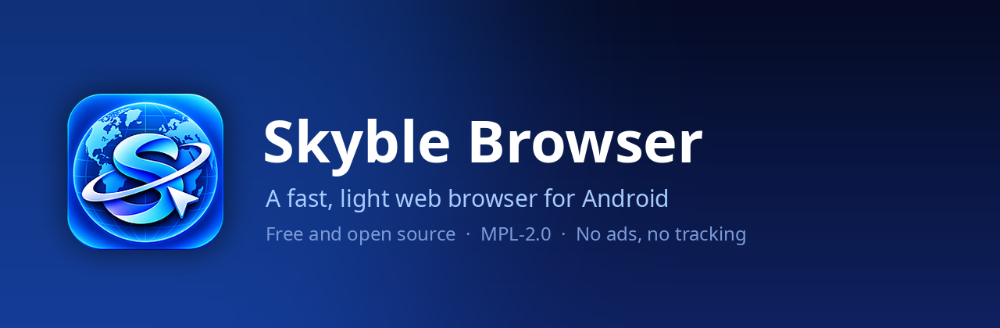
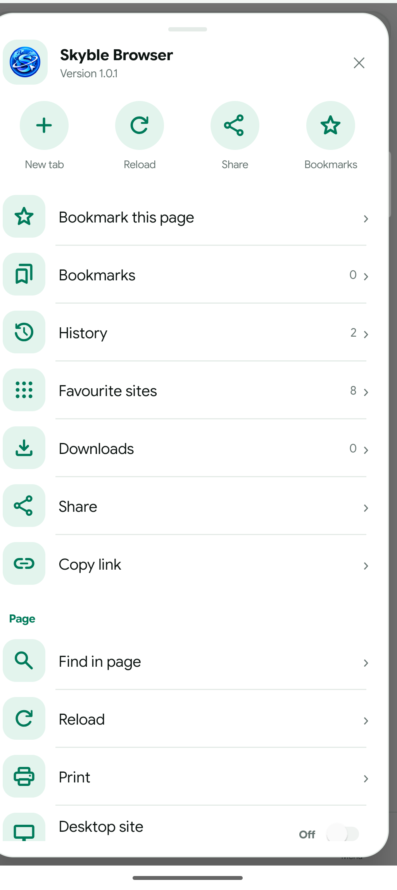
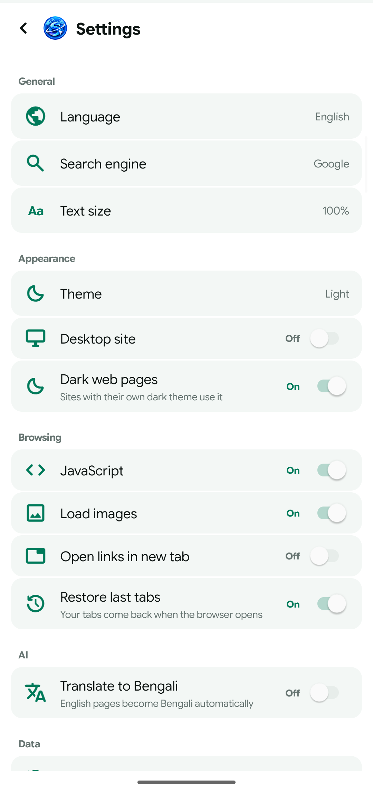
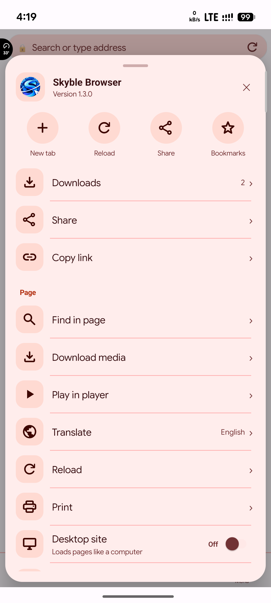

# Skyble Browser



[](LICENSE)
[](https://developer.android.com)
[](https://github.com/Mamun015/skyble-browser/releases)
[](https://github.com/Mamun015/skyble-browser/releases)

**Website: [mamun015.github.io/skyble-browser](https://mamun015.github.io/skyble-browser/)**

A fast, light web browser for Android with a downloader built in. Small
download, quick start, no ads, no tracking, no account. YouTube videos save at up
to 1080p as ordinary MP4 files, and media from other sites lands in the same
download list. Built on the Android System WebView so the engine stays current
with the phone and the app stays under one megabyte.

## Screenshots

<p>




</p>

## Features

**Downloads**
- YouTube video at 1080p, 720p, 480p and 360p from the page's download button.
  High qualities are fetched as separate picture and sound tracks and joined into
  one MP4 with MediaMuxer on the phone
- MP4, WebM, MKV, MP3, M4A, AAC, OGG and WAV taken from the current page, plus
  PDF, ZIP and APK links
- Four parallel connections per file, resume from the byte reached, and a fall
  back to the next quality when the server refuses one
- Progress, speed and cancel in the notification bar; files go to the normal
  Downloads folder
- A finished download shows a bar with Open, and the notification gets an Open
  action as well
- Optional GPL helper app (`plugin/`) with NewPipeExtractor for the rare video
  the built-in resolver cannot read

**Browsing**
- Up to 50 tabs, with a session that comes back after a restart
- Live search suggestions, plus suggestions from your own history and bookmarks
- Home speed dial with Google, Facebook, Instagram, Gmail, GitHub, YouTube,
  Stack Overflow and MDN; press and hold a tile to drag it into place or to edit
  and delete it, and use the plus tile to add any site
- Checks GitHub for a newer build every time it opens and once an hour while it
  stays open, and the browser's own update goes straight from download to the
  install screen
- Find in page, print, share, copy link
- Desktop site mode
- Set Skyble as the default browser with one tap

**Privacy**
- Blocks known ad and tracker hosts (doubleclick, adsterra, taboola and more)
- No analytics, no telemetry, no advertising SDKs
- One-tap clearing of history, bookmarks, cookies, cache or everything
- Invalid certificate warning before a page opens, with an explicit "open anyway"

**Reading**
- Four themes: follow system, always light, always dark, force every page dark
- Pages with their own dark theme keep it
- Text size from 85% to 130%
- Toggles for images and JavaScript

**Language**
- English interface by default
- Full Bengali interface, switchable in Settings

**AI**
- Translate English pages to Bengali from the Settings screen, off by default

**Updates**
- In-app check against GitHub releases; the app tells you when a newer build exists

## Install

1. Download `SkybleBrowser-<version>.apk` from the [latest release](https://github.com/Mamun015/skyble-browser/releases/latest).
2. Open the file and allow installation from your browser or file manager when asked.

Android 5.0 or newer. Updates install over the previous build, no uninstall needed.

## Build from source

There is no Gradle and no Android Studio project. The app builds with the plain
Android SDK tools.

Requirements:

- JDK 17
- `aapt`, `zipalign` and `apksigner` on `PATH`
- `sdk/android.jar` and `sdk/r8.jar` in the repository

```bash
JAVA_HOME=/path/to/jdk-17 PATH=$JAVA_HOME/bin:$PATH bash build.sh
```

`build.sh` packages resources, compiles the sources, dexes with R8, aligns, signs
and verifies the APK.

## Why the APK is small

Skyble does not ship a browser engine. Pages are rendered by the Android System
WebView installed on the phone, which is maintained through Play Store updates.
The result is a sub-megabyte app that inherits engine security fixes without
shipping a second copy of Chromium.

## Project layout

```
src/com/skyble/browser/   Java sources (single activity browser, settings, updater)
assets/home.html          start page
assets/dark.js            dark mode for web pages
assets/translate.js       page translation
docs/                      project website (GitHub Pages)
plugin/                   optional helper app with NewPipeExtractor (GPL-3.0)
fastlane/                 store listing: text, icon, screenshots
assets/icon.png           app artwork for the start page
res/                      icons, adaptive icon layers, strings
build.sh                  build script
```

## Roadmap

- Built-in video player
- Stronger ad filtering with a maintained filter list

## License

Source code: [MPL-2.0](LICENSE). Modify it, ship it, keep the modified files open.

The name **Skyble**, the names **Skyble Browser** and **Skyble Browser for
Android**, the app icon, the home screen logo and the banner are brand assets.
They are **not** covered by the MPL and are all rights reserved. Read
[TRADEMARK.md](TRADEMARK.md) before you fork, publish a build, or upload
anything to an app store.

## Contact

Open an issue on this repository for bug reports, feature requests, or brand
permission requests.
