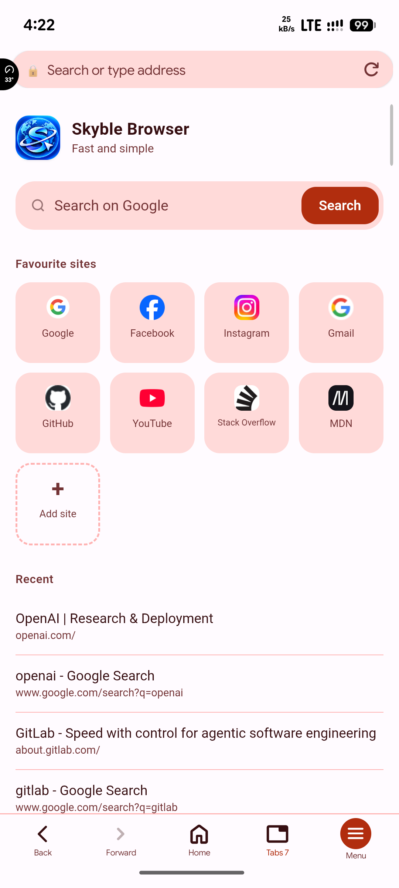

# Skyble Browser


[](LICENSE)
[](https://developer.android.com)
[](https://github.com/Mamun015/skyble-browser/releases)
[](https://github.com/Mamun015/skyble-browser/releases)

**Website: [mamun015.github.io/skyble-browser](https://mamun015.github.io/skyble-browser/)**

**Download page with checksum and install steps: [download](https://mamun015.github.io/skyble-browser/download.html)** · [বাংলা](https://mamun015.github.io/skyble-browser/bn.html)

**Download the latest APK: [SkybleBrowser-1.3.1.apk](https://github.com/Mamun015/skyble-browser/releases/latest)** (version 1.3.1, Android 5.0+, about 3 MB)

A fast, light web browser for Android with a downloader and a video player built
in. No ads, no tracking, no account. Pages translate themselves as they open,
and on Android 12+ the palette comes from your wallpaper. Tabs show up as a grid
of page previews, videos from websites and from your download list play in the
app's own player, YouTube videos save at up to 1080p as ordinary MP4 files, and
media from other sites lands in the same download list. Downloads can be handed
to the download app you already use. Pages are drawn by the Android System
WebView so the engine stays current with the phone.

## Screenshots

<p>



</p>

## Features

**Downloads**
- YouTube video at 1080p, 720p, 480p and 360p from the page's download button.
  High qualities are fetched as separate picture and sound tracks and joined into
  one MP4 with MediaMuxer on the phone
- MP4, WebM, MKV, MP3, M4A, AAC, OGG and WAV taken from the current page, plus
  PDF, ZIP and APK links
- Four parallel connections per file, resume from the byte reached, and a fall
  back to the next quality when the server refuses one
- Progress, speed and cancel in the notification bar; files go to the normal
  Downloads folder
- A finished download shows a bar with Open, and the notification gets an Open
  action as well
- Choose which app downloads a file: the built-in downloader or a download
  manager already on the phone (ADM and similar), remembered if you want, with
  a download manager row in Settings
- Optional GPL helper app (`plugin/`) with NewPipeExtractor for the rare video
  the built-in resolver cannot read

**Video player**
- Videos from websites open in the app's own player instead of the page: MP4,
  WebM, MKV, MOV, MP3, M4A, HLS (`.m3u8`) and DASH (`.mpd`)
- Videos you downloaded open in the same player when you tap them in the
  download list
- Swipe up or down on the left half for brightness, on the right half for
  volume, and sideways to seek
- Fit, Fill and Stretch aspect ratios; 0.5x to 2x speed; audio track picker for
  videos with more than one language; mute
- Hardware or software decoding, switchable while a video plays, so a video that
  stalls on your chipset still plays
- The progress bar only moves forward, so it does not jump ahead and back during
  playback, and swipes near the control bar never start a seek by mistake
- Media the page hides behind `blob:` gets played too: the app watches the
  network requests the page makes and hands the real stream to the player

**Translate**
- Automatic page translation with Google Translate, on by default: every page
  that is not in English is translated as soon as it opens, with a progress
  counter and a button that brings the original back
- Turn auto translate off and a "translate this page" pill appears on foreign
  pages instead
- A searchable picker with every Google Translate language, so the target
  language is one tap away

**Browsing**
- Up to 50 tabs, with a session that comes back after a restart
- The tab screen is a grid of square cards, each with a picture of the page; a
  thin border on every card, a thicker accent border on the active tab, and the
  grid stays open when you close a tab
- Live search suggestions, plus suggestions from your own history and bookmarks
- Home speed dial with Google, Facebook, Instagram, Gmail, GitHub, YouTube,
  Stack Overflow and MDN; press and hold a tile to drag it into place or to edit
  and delete it, and use the plus tile to add any site
- Checks GitHub for a newer build every time it opens and once an hour while it
  stays open, and the browser's own update goes straight from download to the
  install screen
- Find in page, print, share, copy link
- Press and hold a link for the menu: copy link, copy link text, share, open in
  a new tab, download, add to home, or play in the player when the link is a
  video file
- Links open in a new tab by default, so ads and popups cannot take over the tab
  you are reading
- Desktop site mode
- Set Skyble as the default browser with one tap

**Privacy**
- Blocks known ad and tracker hosts (doubleclick, adsterra, taboola and more)
- No analytics, no telemetry, no advertising SDKs
- One-tap clearing of history, bookmarks, cookies, cache or everything
- Invalid certificate warning before a page opens, with an explicit "open anyway"

**Reading**
- Four themes: follow system, always light, always dark, force every page dark
- On Android 12+, the palette follows your phone's Material You wallpaper colors
- Pages with their own dark theme keep it
- Text size from 85% to 130%
- Toggles for images and JavaScript

**Language**
- English interface by default
- Full Bengali interface, switchable in Settings

**AI**
- Page translation is powered by Google Translate. The page text goes to
  translate.googleapis.com, with no key and no account; text leaves the phone
  only when a page is translated

**Updates**
- In-app check against GitHub releases; the app tells you when a newer build exists

## Install

1. Download `SkybleBrowser-<version>.apk` from the [latest release](https://github.com/Mamun015/skyble-browser/releases/latest).
2. Open the file and allow installation from your browser or file manager when asked.

Android 5.0 or newer. Updates install over the previous build, no uninstall needed.

## Build from source

There is no Gradle and no Android Studio project. The app builds with the plain
Android SDK tools.

Requirements:

- JDK 17
- `aapt`, `zipalign` and `apksigner` on `PATH`
- `sdk/android.jar` and `sdk/r8.jar` in the repository

```bash
JAVA_HOME=/path/to/jdk-17 PATH=$JAVA_HOME/bin:$PATH bash build.sh
```

`build.sh` packages resources, compiles the sources, dexes with R8, aligns, signs
and verifies the APK.

## Why the APK is small

Skyble does not ship a browser engine. Pages are rendered by the Android System
WebView installed on the phone, which is maintained through Play Store updates.
The result is a small app that inherits engine security fixes without shipping a
second copy of Chromium.

The video player is ExoPlayer (AndroidX Media3, Apache-2.0). It adds about 2 MB
of code and nothing else in the app got heavier.

## Project layout

```
src/com/skyble/browser/   Java sources (browser, settings, player, updater)
assets/home.html          start page
assets/dark.js            dark mode for web pages
assets/translate.js       page translation
assets/player.js          hands page videos to the in-app player
libs/                     Media3 / ExoPlayer jars for the player
docs/                      project website (GitHub Pages)
plugin/                   optional helper app with NewPipeExtractor (GPL-3.0)
fastlane/                 store listing: text, icon, screenshots
assets/icon.png           app artwork for the start page
res/                      icons, adaptive icon layers, strings
build.sh                  build script
```

## Roadmap

- Stronger ad filtering with a maintained filter list
- Subtitles and playlist play in the video player

## License

Source code: [MPL-2.0](LICENSE). Modify it, ship it, keep the modified files open.

The name **Skyble**, the names **Skyble Browser** and **Skyble Browser for
Android**, the app icon, the home screen logo and the banner are brand assets.
They are **not** covered by the MPL and are all rights reserved. Read
[TRADEMARK.md](TRADEMARK.md) before you fork, publish a build, or upload
anything to an app store.

## Contact

Open an issue on this repository for bug reports, feature requests, or brand
permission requests.
